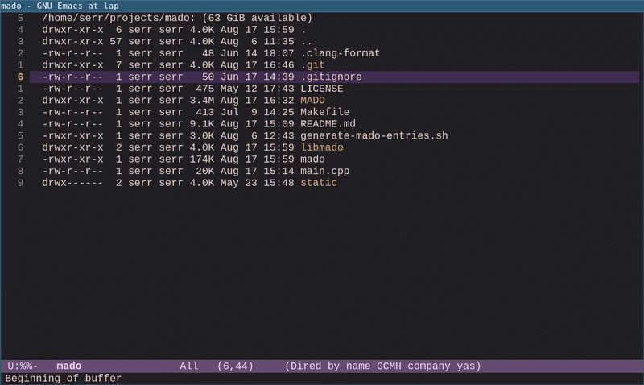

# emado

An Emacs interface for Mado, a command-line organizer for tasks and
notes. Browse repository statistics, query entries, create entries from
templates, and open their Markdown files directly from Emacs.
[Mado documentation](https://github.com/laserattack/mado2)



## Installation

emado requires Emacs 28.1 or later, Transient 0.12 or later, and a current
`mado` executable from the linked repository. Make sure Emacs can find
`mado` on its `exec-path`, or set `emado-executable` to its absolute path.

Copy `emado.el` to a directory on your Emacs `load-path` and add this to
your configuration.

```elisp
(require 'emado)
(emado-default-bindings)
```

This binds `C-c e` to `emado-info`. To choose another key, bind
`emado-info` yourself.

## Getting started

From a buffer in your project, run `M-x emado-info` or press `C-c e`.
Mado looks for the nearest `MADO/` directory starting from the buffer's
working directory and checking its ancestors. In the `*emado*` buffer,
use `s w` to set a working directory for the session or `s W` to clear it.

- If you need a repository, use `i i` to initialize one. The init menu's
  `f` option forces initialization in the chosen directory even if an
  ancestor already contains a repository.
- Use `c c` to create an entry with Mado's default task header. To pick
  a template first, use `c t`, select a name, then press `c`.
- Use `l a` to list all entries or `l l` to enter a Mado query such as
  `status = open and tag = bug`. For a quick fuzzy name search, use
  `l f n`. The list menu also controls sorting and visible fields.
- On an entry line, press `RET` to open `MAIN.md`, `o` to open its
  directory, or `d` to delete the entry after confirmation. Use `r`
  for removal by query. Removing an entry also deletes its attachments.
- Press `h` to open the main menu or `g` to repeat the last command.

## Entries and templates

Each entry has its own directory under `MADO/`, with a UTC timestamp
such as `20261106-120000` in its name. Keep notes in `MAIN.md` and
related files alongside it.

Mado uses the first existing template directory under `MADO/` in this
order: `templates/`, `.templates/`, `_templates/`. Emado offers the
names of its Markdown templates without the `.md` extension. Mado
initialization creates or restores the standard `note.md` and
`task.md` templates. Keep custom templates in separate files, such as
`bug.md`.
